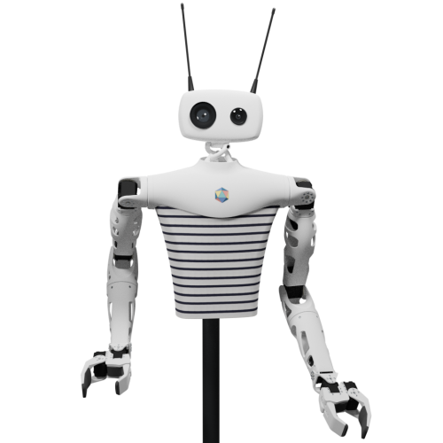
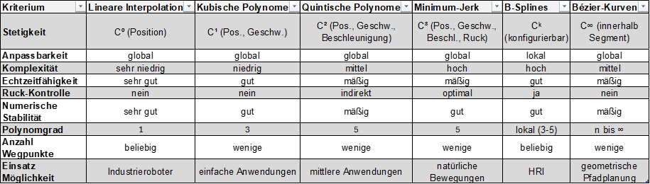
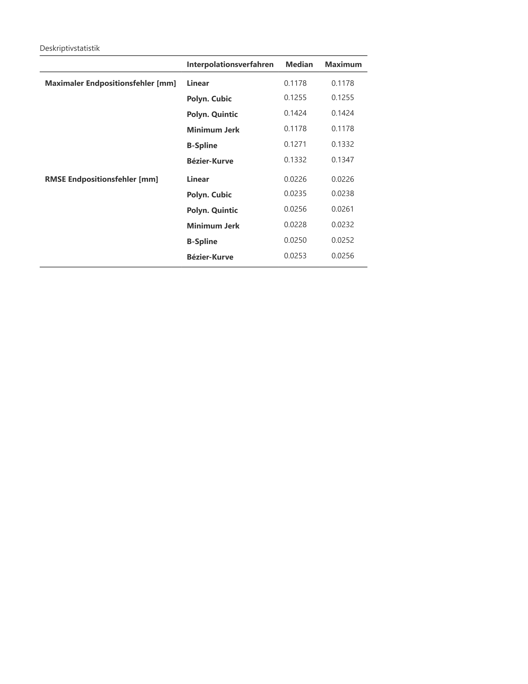
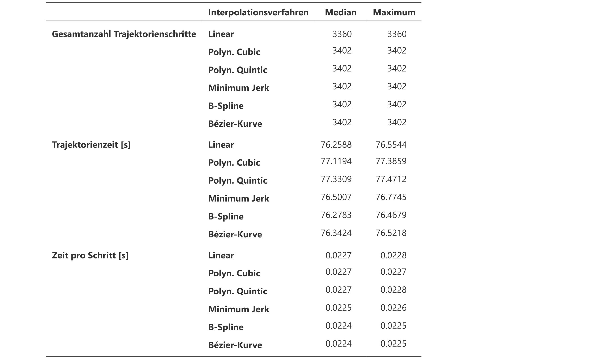
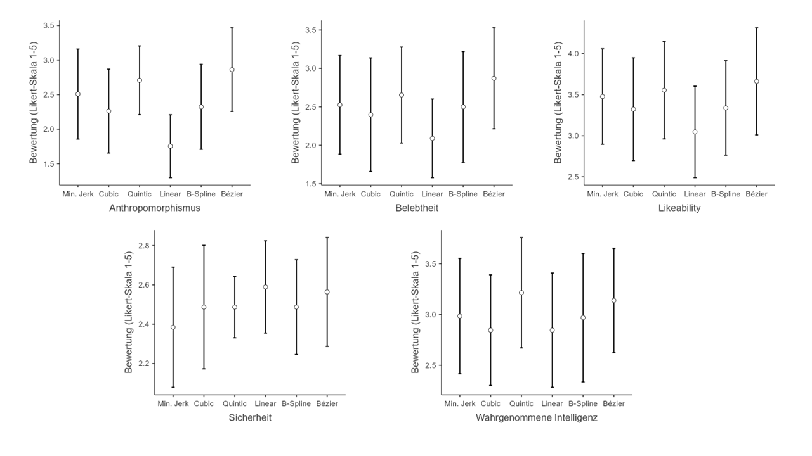

# Trajectory Smoothing for the Humanoid Robot Reachy

  

*Image source [Pollen Robotics](https://pollen-robotics.github.io/reachy-2023-docs/advanced/overview/full-kit/reachy-advanced-kit_hubc34c1a491cdc3dbec46112c43fcbade_296143_500x0_resize_box_2.png)

## Project Overview

This project was developed as part of my master's thesis and focuses on improving the movement smoothness of the humanoid robot Reachy 2023.
I used Linux and ROS2 to accomplish my goals. 

The main goal was to implement and compare different trajectory interpolation methods to achieve smoother and more natural robot movements. Another important aspect was investigating how these different movement styles are perceived by humans.

The project combines robot programming, trajectory planning, data analysis, and human-robot interaction.

## Technologies Used
- Programming Language:
  - Python
  - R
- Operating System: Linux (Ubuntu 22.04)
- Robotics Framework: ROS 2 Humble
- Robot: Reachy 2023
- Libraries & Tools:
  - Reachy SDK
  - NumPy
  - SciPy
  - IKPy

## Implemented Features
I implemented six different trajectory interpolation methods to control the robot's joint movements:
#### 1. Minimum Jerk Interpolation
#### 2. Polynomial Spline (Cubic) Interpolation
#### 3. Polynomial Spline (Quintic) Interpolation
#### 4. B-Spline Interpolation
#### 5. Bézier Curve Interpolation
#### 6. Linear Interpolation (No Interpolator)

These methods allow the robot to perform movements with different velocity and acceleration profiles.
The implementation makes it possible to execute and compare the different movement styles on the physical robot.

## Evaluation
The implemented methods were evaluated from two perspectives:

### 1. Technical Evaluation
The robot's movements were analyzed using different performance metrics, including:
- Maximum jerk
- Maximum joint velocity
- Root Mean Square Error (RMSE) of jerk

### 2. Human Perception Online Study 
An online study was conducted to investigate how humans perceive the different movement styles.
Participants watched videos of the robot performing movements using the six interpolation methods and evaluated them using the Godspeed questionnaire.
The evaluation focused on aspects such as anthropomorphism, animacy, likeability, perceived intelligence, and perceived safety.

## Evaluation Results

### Interpolation Methods Comparison

### Dynamic Metrics

### Position Accuracy

### Timing Metrics

### Human perception study (Godspeed Questionnaire)

### Key Findings
- Linear interpolation produced the highest jerk values.
- Minimum Jerk and Quintic interpolation achieved particularly low jerk values.
- The human perception study showed that technically smoother movements were not necessarily perceived as the most natural or likeable.
- Bézier interpolation received favorable ratings in several subjective evaluation categories.

## What I Learned
Through this project, I gained practical experience in:
- Developing and implementing algorithms in Python
- Working with Linux and ROS 2
- Integrating software with a physical robotic system
- Analyzing and comparing different technical solutions
- Collecting and evaluating experimental data
- Investigating human-robot interaction
